# adev

adev builds software from a fixed route of documents. A stage owns one document, one role agent fills it, gates judge the result, and anything the agent cannot decide becomes a question for the operator. The route belongs to the registry. The agent never picks the next stage.

This file explains the patterns behind that shape, and the two we refuse to use. Setup, layers and the commands live in `adev/README.md`; the rules for changing the code live in `AGENTS.md`.

## Pattern 1. Prompt chaining

A task becomes a pipeline where the output of one step is the input of the next. Each step does one narrow job.

```
[input] -> (step 1: analyse) -> (step 2: generate) -> (step 3: validate) -> [result]
```

Instead of one prompt that says "write the article, check it, translate it", you make three calls: one writes, one edits, one translates.

Why: predictability. A model handles an atomic task better than a long multi-step instruction, and a failure points at one step instead of the whole answer.

Where adev uses it: every stage is a chain of code steps, and only one of them is a model call. `StageService.Run` reads the input forms, builds the context, calls the model, stores the draft, runs the gates. A stage that writes two documents makes two calls (`adev/internal/usecase/stage_service.go`, the loop over `stage.Outputs`).

Example, from the first stage: read the operator input, ask the model for the BRD draft, check the blocking gaps, store the version.

## Pattern 2. Orchestrator–workers

One controller splits the job, hands pieces to workers, and merges the results.

```
              /-> [worker 1] --\
[input] -> (orchestrator) -> [worker 2] --> (orchestrator: merge) -> [result]
              \-> [worker 3] --/
```

Why: the work has more parts than one prompt can hold, and each part needs its own small context.

Where adev uses it: composite documents. The first call returns a skeleton, then one call per entry fills it: one call per FR, one per container, one per package. `batchPlans` (`stage_service.go`) holds the plan, `detailLevel` walks it, `detailCall` builds a prompt for exactly one entry.

The controller here is code. The classic form lets the orchestrator decide how many workers to start; adev keeps that decision in a table, so the same input walks the same split. The model never sees the whole document and never chooses the next entry.

Parallel execution is not implemented. `detailLevel` walks the list in order, one call at a time.

## Pattern 3. Routing

A router reads the input and sends it down one path. The decision is a rule, not a model opinion.

Where adev uses it: `domain.NextStage` and the route table in `adev/internal/domain/stage.go` own the order. A failed verdict enters 08.R, a passing one goes to 09, and a change request takes the change route. The pipeline stays auditable because the same inputs walk the same path.

## Pattern 4. Human in the loop

The model marks what it cannot decide, a person answers, and the answer returns to the same step.

```
model -> [gap: question + options] -> operator -> same tool -> stored form
```

Where adev uses it: a gap (`adev/internal/domain/form_atoms.go`) carries a question, a JSON pointer, and a few options. A blocking gap stops the stage and publishes an operator request. The answer rewrites the stored payload in place, without a new form version, so the choice lands where the uncertainty was.

Why: an assumption the operator never saw is a defect with a delay. The model writes down the uncertainty instead of inventing a value, and the cost of the decision lands on the person who owns it.

## Who decides what



- **Route registry** (`domain/stage.go`): the order of stages. No model call.
- **Orchestrator** (`usecase/orchestrator.go`): starts the stage, advances the cursor on success.
- **Stage runner** (`usecase/stage_service.go`): builds the focused context, fans out per entry, merges the answers.
- **Model call**: one unit of context in, one unit of text out. No tools, no history.
- **Submit tool** (`FormService.Submit`): checks the envelope, assigns ids, stores the version.
- **Gates** (`domain/form_*.go`): schema and domain rules. They judge the stored draft, not the model.
- **Operator**: answers gaps and picks variants. The answer re-enters the same tool.

The model owns one node in that picture: one call, one piece of text. Code owns the order, the tool, and the gates. The operator owns the open questions.

Diagram source: `docs/diagrams/stage-run.html`.

## Choosing between the two

| | Prompt chaining | Orchestrator–workers |
|---|---|---|
| Structure | fixed, linear, decided before the run | flexible, branches at run time |
| Parallelism | none, steps run in order | high, workers run at once |
| Task shape | low to medium, known process | high, unknown number of parts |
| Token cost | fixed number of calls | dynamic calls plus coordination |
| Next step decided by | code | code here, a model in the classic form |

Chaining fits a document with a fixed outline. Orchestrator–workers fits a document whose length depends on the content, such as the FR list or the container list.

## What we do not use

**Evaluator–optimizer loops.** The model gets one attempt per form. A gate mismatch is stored on the draft as an indicator, and the operator decides whether to rerun. An auto-repair loop multiplies token cost and hides the moment the model stopped being able to answer.

**ReAct.** The model never chooses an action and never reads an observation back. It receives one unit of context and returns one unit of text; code owns the order and the tools. This gives up the model's ability to check its own work against the environment, and it buys predictable cost and a route that cannot drift.
